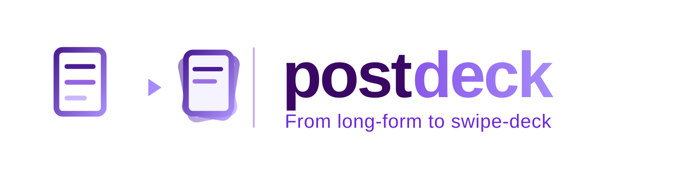

<p align="center">
  <strong>English</strong> · <a href="./README_ZH.md">简体中文</a>
</p>

<p align="center">
  
</p>

<p align="center">
  <a href="LICENSE"></a>
  <a href="postdeck/SKILL.md"></a>
</p>

A blog post and a swipe-deck note are different media. The post rewards depth; the feed rewards the first card. Paste paragraphs into a note and you get a wall nobody reads; screenshot the rendered article and it's illegible on a phone.

postdeck is an Agent Skill built around that observation: **the conversion is a redesign, not a copy-paste.** It distills a technical post into a card deck — vendored math, hand-built diagrams, one idea per page — then posts a *private/draft preview* (or hands you the files) so you review the real thing before anyone else sees it. It works on any platform you can name — Xiaohongshu via the `xhs` CLI is the classic worked example below.

```bash
npx skills add OpenMedia-Lab/postdeck -g
```

## What it actually does


Seven stages, and the interesting design choice is where the human sits:

- **A clarify round opens every run.** One batch of multiple-choice questions — each with options plus a free-text Other — pins down the platform, style references, render path, and posting mechanism. Nothing downstream guesses.
- **The preview post is the review surface.** Where the platform supports it, the note lands as draft/private — you review it rendered, in the app, exactly as readers will see it. Revisions re-post the preview until you approve.
- **Going public is always your call.** An in-app visibility flip or an approved delete-and-repost — neither happens without you saying so.

## The clarify round

Every task starts with one batch of questions:

| Question | Typical options | Default |
|---|---|---|
| Target platform? | Xiaohongshu · 知乎 · 公众号 · X/Twitter · Other | whatever the prompt implies |
| Style references? | my own past posts · URLs I give you · house style · none | your account's posts, if fetchable |
| Render path? | HTML → PDF → PNG · page screenshots · Other toolchain | HTML → PDF → PNG |
| Post mechanism? | platform CLI/API · draft-only · hand me the files | CLI/API when configured |

Anything already answered in your prompt is skipped; anything unanswered gets a marked default. Other is a real path — name a platform or toolchain the skill hasn't met and it becomes the spec for the run.


## The part most tools skip

The stages that matter aren't the conversion — they're **voice**, **rendering**, and **inspection**:

- **Does it sound like you?** The agent reads your account's published posts and lifts the voice from evidence — title habits, body skeleton, link placement, emoji quirks — instead of inventing a style.
- **Do the cards survive the feed?** Cards are laid out as a fixed-geometry HTML deck — KaTeX vendored locally so a dead CDN can't leave raw `\(` on a page, system CJK fonts, the source blog's own accent hue — then printed HTML → PDF → PNG so page boundaries are exact.
- **Was every page actually looked at?** Inspect reads every PNG: clipped code lines, raw TeX, footer overflow, diagrams whose arrows miss their boxes. "Probably fine" is not inspection.
- **Is the intermediate mess gone?** Vendored deps, PDFs, scratch venvs, and one-off scripts are deleted at the end; the deck source and final PNGs stay as the record of what's live.

## Classic example: Xiaohongshu

This skill was distilled from a real conversion — a ~5k-word MoE technical post became a 10-page deck posted as a private Xiaohongshu note for review. That run is why the defaults look like this:

- **3:4 portrait cards** (1242×1656 CSS px → ~2000px PNGs) — the xhs feed geometry.
- **`xhs` CLI as the posting mechanism** — `xhs read`/`my-notes` to learn the account's voice, `xhs post --private` as the preview surface, `xhs my-notes` to verify `仅自己可见`.
- **Conversational Chinese copy** — `如题` opening, sharp insight up front, `博客地址：<url>` link-back, topic entities resolved via `xhs topics`.
- **The pitfalls it encodes** — `--images` needs one flag per file, PyMuPDF goes in a scratch venv, page 6's code block got clipped and was only caught by reading the PNG.

Other platforms reuse the same pipeline; only the Intake answers change — aspect ratio, voice source, posting adapter.

## What you get back

| Moment | Artifact |
|---|---|
| After Intake | Task card — source, platform, refs, render path, post mechanism, mode |
| After Adapt | Page plan (`page · title · carries`) + full copy draft |
| After Render | Per-page PNGs at feed resolution |
| After Inspect | QA report — what was clipped, what was fixed |
| After Post | Preview live (private/draft) or a clean handoff bundle |
| Terminal | Report — file manifest, cleanup confirmation, judgment calls flagged |

The pipeline also takes partial jobs: cards only, copy only, restyle an existing deck — Intake routes you onto the right slice.

## Try it

Install the skill, then just ask:

```text
Turn this post into a Xiaohongshu note — style like my previous ones, post private for review: https://myblog/posts/llm-moe/
```

```text
Cards only for the normalization post — 4:5, for an X image thread. Same deck style as last time.
```

```text
Page 6's code block is clipped — fix and repost the preview.
```

The first request runs the full pipeline and ends with a private note you review in the app. The second shows how clarify answers redirect the same machinery at another platform.

## Skill structure

| File | Load when |
|---|---|
| [`postdeck/SKILL.md`](postdeck/SKILL.md) | Entry: pipeline, gates, defaults |
| [`references/intake.md`](postdeck/references/intake.md) | Starting any task; clarify questions, source, modes, authorization |
| [`references/adapt.md`](postdeck/references/adapt.md) | Distilling the article into a page plan and copy |
| [`references/layout.md`](postdeck/references/layout.md) | Building the paged HTML deck |
| [`references/render.md`](postdeck/references/render.md) | HTML → PDF → PNG and per-page inspection |
| [`references/post.md`](postdeck/references/post.md) | Posting mechanisms, preview verification, cleanup |
| [`templates/cards.html`](postdeck/templates/cards.html) | The card-deck base template |
| [`scripts/pdf2png.py`](postdeck/scripts/pdf2png.py) | PDF → per-page PNG rasterizer |

Progressive disclosure: read the current stage's reference only.

## Development

Diagrams live in `docs/diagrams/` — Archify JSON sources rendered to standalone HTML and exported as auto-themed SVG, plus the hand-drawn brand lockup. Regenerate with `archify render <type> <json> <html> --quality showcase`, then Export → SVG from the HTML viewer (serve the folder over HTTP — `file:` is blocked in headless browsers).

## License

[MIT](LICENSE)
