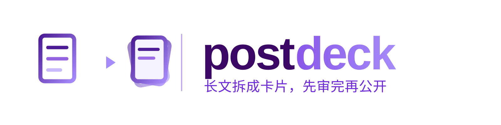

<p align="center">
  <a href="./README.md">English</a> · <strong>简体中文</strong>
</p>

<p align="center">
  
</p>

<p align="center">
  <a href="LICENSE"></a>
  <a href="postdeck/SKILL.md"></a>
</p>

博客文章和卡片式图文笔记是两种媒介：文章奖励深度，信息流奖励第一张卡片。把段落贴进笔记只会得到没人看的文字墙；直接截图文章页面，在手机上根本看不清。

postdeck 是围绕这个观察做的 Agent Skill：**转换是重新设计，不是复制粘贴。** 它把技术长文蒸馏成卡片图集——本地化渲染的公式、手绘结构图、一页一个点——然后发成**私密/草稿预览**（或直接交付文件），让你以读者视角审完之后，再决定要不要公开。平台不限——下面的小红书是通过 `xhs` CLI 走通的经典示例。

```bash
npx skills add OpenMedia-Lab/postdeck -g
```

## 它具体做什么


七个阶段，真正的设计点在于**人坐在哪**：

- **每次任务先澄清一轮。** 一批多选题——每题给选项 + 可自由填写的 Other——把平台、风格参考、渲染路径、发布方式一次问清。之后的阶段不再需要猜。
- **预览本身就是审稿界面。** 平台支持的话，笔记以草稿/私密形态落地——你在 App 里以读者视角审真实渲染效果。要改就重发预览，直到你点头。
- **公开永远由你来决定。** App 里手动翻转可见性，或批准后删除重发——你不发话，什么都不会公开。

## 澄清一轮

每次任务开头问一批问题：

| 问题 | 常见选项 | 默认 |
|---|---|---|
| 目标平台？ | 小红书 · 知乎 · 公众号 · X/Twitter · Other | 以 prompt 推断为准 |
| 风格参考？ | 我账号的历史帖子 · 我给的链接 · skill 默认风格 · 不需要 | 能抓到就用账号帖子 |
| 渲染路径？ | HTML → PDF → PNG · 页面截图 · 其他工具链 | HTML → PDF → PNG |
| 发布方式？ | 平台 CLI/API · 只做到草稿 · 给我文件自己发 | 有配置就用 CLI/API |

prompt 里已经答了的跳过；没答的给标注好的默认值。Other 是真实路径——说一个 skill 没见过的平台或工具链，它就成为本次任务的规范。


## 大多数工具跳过的那部分

真正值钱的不是转换本身，是**文风**、**渲染**和**逐页检查**：

- **读起来像你吗？** Agent 会先读你账号已发布的帖子，从证据里学文风——标题习惯、正文骨架、链接位置、表情习惯——而不是凭空编一种风格。
- **卡片在信息流里扛得住吗？** 卡片用固定几何的 HTML 排版——KaTeX 依赖本地化，CDN 挂了也不会在页面上留下 `\(`；系统 CJK 字体；主题色沿用博客的 accent hue——再走 HTML → PDF → PNG，页边界精确到像素。
- **每一页都真的看过吗？** Inspect 会逐张读 PNG：被裁掉的代码行、没渲染的公式、溢出页脚的内容、箭头没接上盒子的图。「大概没问题」不算检查——被裁的页面不重发就救不回来。
- **中间文件清干净了吗？** 本地化的依赖、PDF、临时 venv、一次性脚本在结束时全部删除；卡片源码和最终 PNG 保留，作为线上内容的记录。

## 经典示例：小红书

这个 skill 提炼自一次真实转换——一篇约 5000 字的 MoE 技术文章变成 10 页图集，以私密笔记发到小红书供审阅。那次实践解释了这些默认值：

- **3:4 竖版卡片**（1242×1656 CSS px → 约 2000px PNG）——小红书信息流的几何。
- **`xhs` CLI 作为发布机制**——`xhs read`/`my-notes` 学账号文风，`xhs post --private` 作预览，`xhs my-notes` 验证「仅自己可见」。
- **口语化中文文案**——「如题」开头、核心 insight 前置、`博客地址：<url>` 回链、话题经 `xhs topics` 解析后挂载。
- **踩过的坑都编进去了**——`--images` 每图一个 flag、PyMuPDF 进临时 venv、第 6 页代码块被裁只能靠读 PNG 发现。

换平台时流水线不变，只是 Intake 的答案不同——宽高比、文风来源、发布适配器。

## 你会拿到什么

| 时机 | 产物 |
|---|---|
| Intake 之后 | 任务卡——源文、平台、参考、渲染路径、发布方式、模式 |
| Adapt 之后 | 分页计划（`页 · 标题 · 承载`）+ 完整文案草稿 |
| Render 之后 | 逐页 PNG，信息流分辨率 |
| Inspect 之后 | QA 报告——哪里被裁了、修了什么 |
| Post 之后 | 预览上线（私密/草稿）或干净的交付包 |
| 终态 | 交付报告——文件清单、清理确认、如实标注的可斟酌点 |

流水线也接局部任务：只出卡片、只写文案、重排已有图集——Intake 会把你路由到对应的切片上。

## 试试看

装好 skill，直接说：

```text
把这篇文章转成小红书笔记，风格参考我之前的笔记，发私密让我review：https://myblog/posts/llm-moe/
```

```text
归一化那篇只要卡片，4:5，发 X 图片帖用。沿用上次图集的风格。
```

```text
第 6 页代码块被裁了——修好重新发预览。
```

第一个请求跑完整流水线，停在一条你在 App 里审的私密笔记；第二个展示澄清答案如何把同一套机器导向另一个平台。

## Skill 结构

| 文件 | 何时加载 |
|---|---|
| [`postdeck/SKILL.md`](postdeck/SKILL.md) | 入口：流水线、闸门、默认值 |
| [`references/intake.md`](postdeck/references/intake.md) | 任务开始；澄清问题、源文、模式、授权 |
| [`references/adapt.md`](postdeck/references/adapt.md) | 把文章蒸馏成分页计划和文案 |
| [`references/layout.md`](postdeck/references/layout.md) | 搭建分页 HTML 图集 |
| [`references/render.md`](postdeck/references/render.md) | HTML → PDF → PNG 与逐页检查 |
| [`references/post.md`](postdeck/references/post.md) | 发布机制、预览验证、清理 |
| [`templates/cards.html`](postdeck/templates/cards.html) | 卡片图集基础模板 |
| [`scripts/pdf2png.py`](postdeck/scripts/pdf2png.py) | PDF → 逐页 PNG 栅格化 |

渐进式披露：只读当前阶段的 reference。

## 开发

图都在 `docs/diagrams/`——Archify JSON 源文件渲染成独立 HTML 后导出双主题 SVG，外加手绘的 brand lockup。重新生成：`archify render <type> <json> <html> --quality showcase`，然后在 HTML viewer 里 Export → SVG（目录要起 HTTP 服务，headless 浏览器拦 `file:`）。

## License

[MIT](LICENSE)
